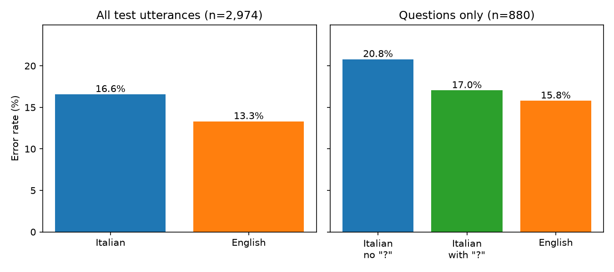
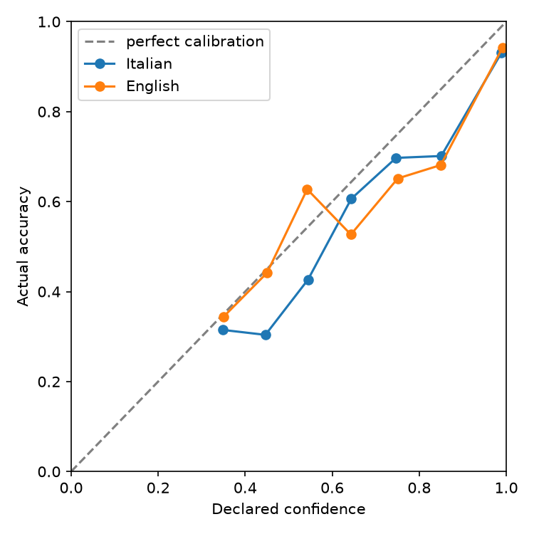
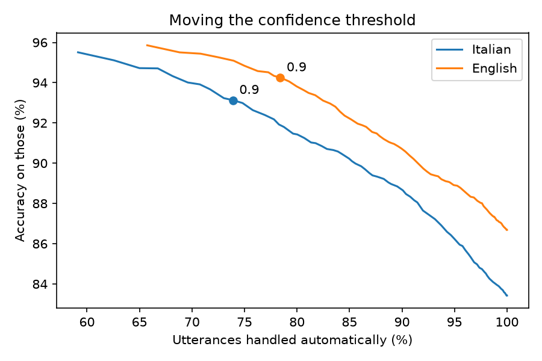

# Jev Italian benchmark on MASSIVE 1.1

| | |
|---|---|
| **Task** | Intent classification on parallel short voice commands, Italian vs English |
| **Result** | 83.4% IT vs 86.7% EN |
| **Dataset** | 2,974 parallel utterances (MASSIVE 1.1, test split) |
| **Model** | Jev 1.13.0 |
| **Finding** | ~1.1 pp of the 3.3 pp gap appears attributable to missing punctuation in Italian questions |

Jev, the decision model released by TypeSafe AI in September 2026, has so far been tested mainly in English. I ran it on the same sentences in Italian and in English from Amazon's MASSIVE dataset and compared the results.

This benchmark measures **Italian vs English performance on parallel short voice-command intent classification**. It does not measure how well Jev understands Italian in general (see [What this benchmark does not show](#what-this-benchmark-does-not-show)).

Short version:

- On the 2,974 test utterances, Jev is 3.3 points less accurate in Italian (83.4% vs 86.7%). The difference is statistically significant.
- About a third of the gap comes from the dataset, not from the model. MASSIVE has no punctuation, and in Italian a yes/no question without "?" is just a statement. Adding the question mark back closes the gap on questions.
- Jev's confidence is too high in both languages, a bit more in Italian, so thresholds tuned on English data shouldn't be reused as they are.

## Why

TypeSafe says English is Jev's primary language and suggests testing other languages on your own data. I couldn't find any public numbers for Italian, so anyone building something for Italian users has nothing to start from.

Think of a shop that routes customer emails with Jev: if Italian is noticeably worse than the English figures, more tickets end up in the wrong place and nobody notices. Same with confidence thresholds: "automate above 0.9" only works if 0.9 means the same thing in both languages.

## Setup

- Model: `jev-1.13.0` (pinned)
- Data: [MASSIVE 1.1](https://github.com/alexa/massive), test split, `it-IT` and `en-US`: 2,974 utterances, each available in both languages
- Task: one Choice question, pick the intent among 60
- Prompt: the same in both runs, with English instructions and English descriptions of the intents ([`intenti.json`](intenti.json))
- Cost: about $0.50 in total

I wanted the language to be the only thing that changes. MASSIVE is parallel (each Italian sentence is a translation of an English one), so both runs see the same requests. I kept the prompt in English for both, because translating it would add a second difference and I wouldn't know which one caused a change in the results.

## Results

### Italian vs English

| | Correct | Accuracy |
|---|---|---|
| Italian | 2,481 / 2,974 | 83.4% |
| English | 2,578 / 2,974 | 86.7% |

On the same utterances: 2,417 correct in both, 332 wrong in both, 161 correct only in English, 64 correct only in Italian. Exact McNemar test on the 161 vs 64: p = 7.9e-11.

### The missing question mark

I found this reading the errors by hand. A lot of sentences Jev got right in English and wrong in Italian looked like *"ho un appuntamento venerdì"* (*"do i have a date on friday"*): Jev picked `calendar_set` instead of `calendar_query`. Reading it as an Italian speaker I'd have done the same, because without "?" that sentence is a statement.

In English the question is in the words ("do", "did", "does"), so it survives without punctuation. In Italian *"ho un appuntamento venerdì"* and *"ho un appuntamento venerdì?"* are the same words, only intonation or the "?" tells them apart. MASSIVE comes from transcribed voice commands with no punctuation, so many Italian questions lose the only thing that made them questions. Here Jev isn't misunderstanding Italian, the information just isn't in the text.

Errors where a question was read as an action on the same topic (e.g. `calendar_query` → `calendar_set`): 44 in Italian, 13 in English.

To check it, I added "?" to the Italian sentences whose English version starts with a question word (do, does, did, is, are, can, what, where, how...), skipping the wake word "olly". The rule only looks at the English sentence, never at the label, so the "?" can't give away the answer. 880 sentences matched. Everything else stayed the same.

| On the 880 questions | Accuracy |
|---|---|
| Italian, no "?" | 79.2% |
| Italian, with "?" | 83.0% |
| English | 84.2% |

- With "?", 40 sentences became correct and 7 became wrong (McNemar p = 1.1e-6).
- Italian with "?" vs English: 33 vs 22 discordant, p = 0.18. So no evidence of a remaining gap on questions, which doesn't prove there's none.
- On the whole test set this takes the gap from 3.3 to about 2.2 points. The error count above (31 extra) and the experiment (33 recovered) roughly agree.



### Calibration



Mean declared confidence vs actual accuracy (number of utterances in brackets):

| Confidence | Italian | English |
|---|---|---|
| 0.0 - 0.5 | 0.39 → 0.30 (150) | 0.41 → 0.41 (114) |
| 0.5 - 0.7 | 0.59 → 0.51 (263) | 0.60 → 0.57 (214) |
| 0.7 - 0.9 | 0.81 → 0.70 (363) | 0.81 → 0.67 (314) |
| 0.9 - 1.0 | 0.99 → 0.93 (2,198) | 0.99 → 0.94 (2,332) |

Automating only answers above a threshold (share automated / accuracy):

| Threshold | Italian | English |
|---|---|---|
| 0.5 | 95% / 86.3% | 96% / 88.5% |
| 0.7 | 86% / 89.8% | 89% / 91.0% |
| 0.8 | 81% / 91.0% | 85% / 92.4% |
| 0.9 | 74% / 93.1% | 78% / 94.3% |
| 0.95 | 68% / 94.3% | 74% / 95.1% |



When Jev says 0.99 it's right 93-94% of the time, so about one "sure" answer in fifteen is wrong. In the lowest bin English is well calibrated and Italian isn't (0.39 declared, 0.30 actual), but with 150 utterances that's a hint more than a result. At the same threshold Italian automates less and is less accurate: to get the ~94% that English gets at 0.9 you need 0.95 in Italian. Some of the "errors" are probably debatable labels, so the real overconfidence is likely a bit smaller.

## If you use Jev in Italian

- Keep punctuation. If you transcribe speech, use something that adds it.
- Tune thresholds on your own Italian data instead of reusing English ones.
- Don't read confidence as a probability you can trust blindly.
- Pin the model version, a new release can move scores and thresholds.

## Limitations

- MASSIVE's Italian sentences are translations, not written by Italian speakers, and some are off (*"b.b.c. world headlines"* became *"rai esteri titoli di testa"*, which means film opening credits).
- The question rule is a heuristic with some false positives (e.g. "where i went today").
- Some MASSIVE labels are debatable and count as errors.
- Prompt only tested in English. Each sentence was run once.

## What this benchmark does not show

- **How well Jev understands Italian in general.** It covers one task (picking 1 of 60 intents) on short voice commands. Emails, long texts, other question types (Score, Noul) or other domains may behave differently.
- **How Jev does on native Italian.** The sentences are translations from English, with the artifacts that come with it.
- **That the remaining ~2.2 pp gap is the model's fault.** It may still include translation problems and debatable labels: this benchmark doesn't separate them.
- **That there is no gap on questions once "?" is added.** p = 0.18 means no evidence of a difference, not evidence that there is none.
- **Anything about other model versions or other models.** Only `jev-1.13.0` was tested, once per sentence.

## Reproduce

Python 3.10+ and a TypeSafe API key in `TYPESAFE_API_KEY`.

```bash
python -m venv .venv
# Windows: .venv\Scripts\activate   macOS/Linux: source .venv/bin/activate
pip install -r requirements.txt

curl https://amazon-massive-nlu-dataset.s3.amazonaws.com/amazon-massive-dataset-1.1.tar.gz --output massive.tar.gz
tar -xzf massive.tar.gz

python benchmark.py       # runs Jev on both languages, can be resumed
python analisi.py         # paired comparison, error examples
python interrogazione.py  # question mark experiment
python confronto.py       # accuracy on the 880 questions
python calibrazione.py    # calibration and thresholds
python mcnemar.py         # significance tests
python grafici.py         # charts in grafici/
```

Raw results are in [`risultati/`](risultati/). Code and comments are in Italian.

## Future work

Directions that build on this benchmark, open to anyone who wants to pick them up:

- **An Italian-native stress test.** Sentences written by native speakers on Italian-specific phenomena: negation, missing or inconsistent punctuation, formal/informal register, idioms, ambiguity, irony, regional words, agreement and pronouns, long sentences, typically Italian expressions. Ideally as minimal pairs, where one small change flips the correct answer. This would move from a controlled benchmark on translated data to a linguistic one.
- **More languages.** The same setup on other MASSIVE languages. A testable hypothesis: languages that, like Italian, mark yes/no questions only with intonation should show the same punctuation effect, while languages that use word order (German) or a particle (Japanese) shouldn't.
- **Other variables.** Italian instructions and intent descriptions, native (not translated) Italian data, other models.

## Credits

- MASSIVE by Amazon, [CC BY 4.0](https://creativecommons.org/licenses/by/4.0/): FitzGerald et al., "MASSIVE: A 1M-Example Multilingual Natural Language Understanding Dataset with 51 Typologically-Diverse Languages", 2022. The files in `risultati/` contain MASSIVE utterances.
- Jev is by TypeSafe AI. This project is independent and not affiliated with them.
- Built with help from Claude (Anthropic).

Code under the MIT license.

I'm Matteo, a computer science student interested in AI. You can find me on [LinkedIn](https://www.linkedin.com/in/matteo-corda-3097053a2/).
